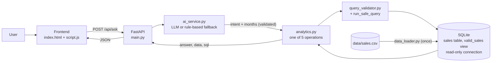

# Architecture

## Who does what
| Step | Component | Job |
|---|---|---|
| 1 | Frontend | Sends the question, shows answer, tables, SQL, errors. No hardcoded answers. |
| 2 | `main.py` | Validates the request (empty, too long, bad body), handles errors, builds the response. |
| 3 | `ai_service.py` | Chooses an operation name. LLM if key present, else keyword rules. Validates LLM output. |
| 4 | `analytics.py` | Runs the fixed SQL for that operation and writes the answer text from the results. |
| 5 | `query_validator.py` / `database.py` | Rejects unsafe SQL, binds parameters, executes on a read-only connection. |
| 6 | SQLite | Stores the data. The `valid_sales` view holds the single revenue definition. |
| 0 | `data_loader.py` | One-time: CSV -> validated rows in SQLite + loading report. |

## Database design
- `sales` (PK `transaction_id`): all loadable rows. `data_issue` is NULL for clean rows. CHECK constraints keep
  quantity, price and discount non-negative. Dates stored as ISO text so month grouping with `strftime` works.
- `rejected_rows`: rows that could not be stored, with reason.
- `valid_sales` (view): `WHERE status='Completed' AND data_issue IS NULL`, adds `month` and
  `revenue = quantity*unit_price - discount_amount`.
- No extra indexes: the table has 51 rows, so an index would add nothing (primary key is indexed automatically).
- SQLite chosen: zero setup, single file, built into Python, enough for this size.

## Design decisions
- Predefined SQL instead of text-to-SQL: simpler, safer, and answers are reproducible.
- The AI picks an operation; it does not calculate. This is what prevents invented figures.
- Read-only connection for requests; only the loader writes.
- Sync endpoints (`def`): FastAPI runs them in worker threads, fine for blocking SQLite and `requests`.
- A new SQLite connection per request: cheap, and avoids thread-sharing problems.
- Percentage change = (later - earlier) / earlier x 100, always earlier -> later in time; undefined (null) if earlier is 0.
